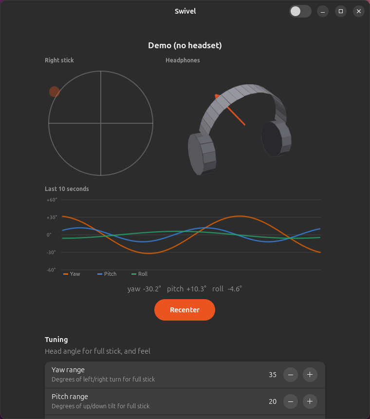

# Swivel

Look around in games by turning your head, using the motion sensor already inside
your Sony headphones. Swivel turns head yaw and pitch into the **right stick of a
virtual gamepad**, so it works in any game where the right stick moves the camera,
including Proton games with no TrackIR or OpenTrack support (Ace Combat, racing and
flight games, third-person games).

Linux only. GTK4 + libadwaita. Your real controller keeps working; the game reads
both.



## Features

- Live views: right-stick position, a 3D model of the headphones following your
  head, and a 10-second yaw/pitch/roll graph
- Tuning that applies instantly: range, deadzone, response curve, smoothing, and
  **game deadzone compensation** (skips the game's own dead stick zone so small
  head turns register instead of feeling sticky)
- Xbox (default) or PlayStation virtual controller. Keep Xbox when you play with a
  real DualSense: under Proton a fake PlayStation pad can confuse a game's native
  DualSense support and scramble the buttons. Swivel only sends input when your head
  moves, so it doesn't keep stealing the "active controller" from your real pad
- Connects the headset's head-tracking channel automatically (most Sony headsets
  connect for audio only)
- Recenter button, plus a signal for a keyboard shortcut
- Demo mode with simulated motion: `SWIVEL_DEMO=1 python3 swivel.py`

## How it works

```
Sony headset ──Bluetooth HID──► sony-tracker ──UDP 127.0.0.1:4242──► Swivel ──uinput──► virtual gamepad ──► game
```

Reading the headset is done by
[SonyTrackerLinux](https://github.com/kdani3/SonyTrackerLinux) (`sony-tracker`),
a Linux port of [sony-head-tracker](https://github.com/NicholasSlattery/sony-head-tracker).
Swivel adds the gamepad output and the app around it.

## Install

Debian/Ubuntu dependencies:

```bash
sudo apt install python3-gi gir1.2-gtk-4.0 gir1.2-adw-1 git build-essential
```

Then:

```bash
git clone https://github.com/trongio/swivel
cd swivel
./install.sh
sudo install -m644 udev/71-swivel.rules /etc/udev/rules.d/
sudo udevadm control --reload-rules && sudo udevadm trigger
```

`install.sh` builds `sony-tracker` if it isn't already on your `PATH`, and adds
Swivel to your app menu. The udev rule lets your user read the headset and create
the virtual controller without root.

## Use

1. Pair and connect your headphones as usual.
2. Open Swivel and flip the switch in the header bar.
3. Start the game, face the screen, and press **Recenter**.

To recenter from a keyboard shortcut (works while the game is fullscreen), bind
`swivel --recenter` to a key. On GNOME the installer can do it for you:

```bash
./install.sh --gnome-shortcut F8
```

If the camera turns the wrong way, use **Invert yaw** / **Invert pitch**. If it
feels sticky near the center, raise **Game deadzone compensation**; if the camera
drifts while you look straight ahead, lower it.

## Compatibility

Tested with a WH-1000XM5 on Ubuntu 24.04 (GNOME 46, X11) playing Ace Combat 8
through Proton. Other Sony models that `sony-tracker` supports should work the same.

## License

MIT
